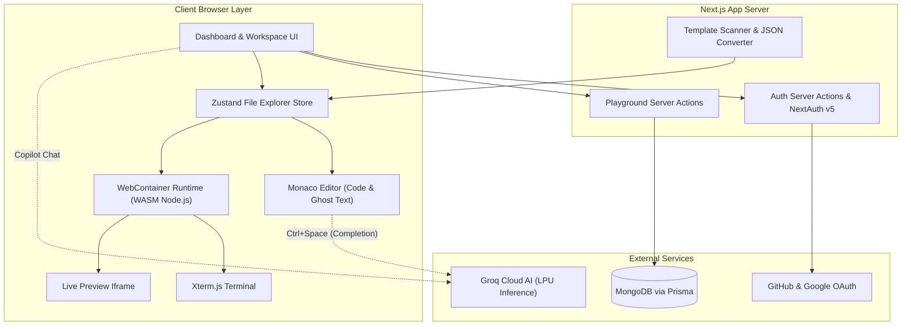
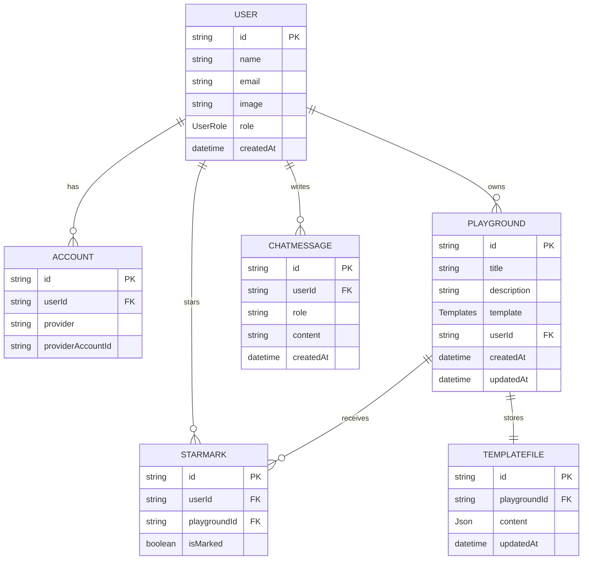

# CodeNova Editor 🚀

CodeNova is a modern, cloud-based, AI-assisted in-browser Integrated Development Environment (IDE) and Web Playground built with **Next.js 16 (App Router)**, **React 19**, **TypeScript**, and **Tailwind CSS 4**. 

It empowers developers to rapidly bootstrap, code, run, and preview full-stack and frontend applications directly in their browser without any local setup or server-side compute. Powered by **StackBlitz WebContainers**, **Monaco Editor**, and **Groq AI (Llama / GPT-OSS / Qwen)**, CodeNova delivers a full desktop-class IDE experience right in the browser.

---

## 🌟 Key Highlights & Features

- **⚡ Zero-Config In-Browser Execution:** Run real Node.js runtimes, package installations, and development servers entirely inside the browser using WebAssembly-powered WebContainers.
- **💻 Desktop-Grade Monaco Editor:** The same code editor engine that powers VS Code, complete with syntax highlighting, customizable theme, multi-tab support, dirty-state indicators, and code navigation.
- **🤖 Dual-Tier AI Assistance:**
  - **Context-Aware Inline Autocomplete:** Ghost-text suggestions powered by Groq models triggered on demand (`Ctrl+Space`) and accepted with `Tab`.
  - **CodeNova Copilot Chat:** Multi-mode AI assistant (Chat, Code Review, Error Fix, Performance Optimization) with streaming support, model switching, and full Markdown/KaTeX math formula rendering.
- **🖥️ Integrated Xterm.js Terminal:** Interactive virtual shell providing real-time streaming logs for `npm install`, build steps, and server status with ANSI color support.
- **🔄 Live Hot-Reloading Preview:** Integrated resizable browser preview iframe connected to the WebContainer's virtual dev server with auto-refresh on save.
- **📂 Starter Template Library:** One-click scaffolding for frontend, backend, and fullstack ecosystems including React (Vite + TypeScript), Next.js, Express, Vue.js, Hono, and Angular.
- **💾 Cloud Persistence:** Automatic synchronization of project trees and user data to MongoDB via Prisma ORM.
- **🔐 Secure Authentication:** Seamless sign-in and account linking using NextAuth.js v5 with GitHub and Google OAuth.
- **📊 Comprehensive Project Dashboard:** Manage projects with ease—create, edit metadata, star/favorite, duplicate, copy shareable links, and delete.

---

## 🛠️ Complete Tech Stack

CodeNova is engineered using a robust, modern web stack spanning in-browser virtualization, cutting-edge UI frameworks, reactive state management, high-speed LLM inference, and scalable database architecture.

### 1. Core Framework & Language
- **[Next.js 16](https://nextjs.org/) (App Router):** Leverages React Server Components, Server Actions for mutations, server-side caching, and route handlers.
- **[React 19](https://react.dev/):** The latest React foundation featuring enhanced concurrent rendering and hooks.
- **[TypeScript 5](https://www.typescriptlang.org/):** Strict end-to-end type safety across client state, server actions, and database schemas.

### 2. In-Browser Virtualization & Sandboxing
- **[@webcontainer/api](https://webcontainers.io/):** StackBlitz's WebAssembly-based Node.js runtime operating inside a secure browser tab. Enables virtual file systems, child process spawning (`npm install`, `npm run start`), and local HTTP server emulation without remote virtual machines.
- **Cross-Origin Isolation:** Utilizes `Cross-Origin-Opener-Policy: same-origin` and `Cross-Origin-Embedder-Policy: require-corp` HTTP headers to unlock high-resolution timers and `SharedArrayBuffer`.

### 3. Editor & Terminal Subsystems
- **[Monaco Editor](https://microsoft.github.io/monaco-editor/) (`@monaco-editor/react` & `monaco-editor`):** Microsoft's industry-standard code editor with custom dark syntax themes, code folding, bracket matching, and custom inline completion providers.
- **[Xterm.js](https://xtermjs.org/) (`@xterm/xterm`):** High-performance terminal emulator in the browser.
  - **`xterm-addon-fit`:** Auto-resizes terminal viewport to fit container panels.
  - **`xterm-addon-search`:** Terminal buffer text search capabilities.
  - **`xterm-addon-web-links`:** Detects and makes hyperlinks clickable in terminal output.

### 4. Artificial Intelligence & LLM Inference
- **[Groq Cloud API](https://groq.com/):** Ultra-low-latency LPU inference engine compatible with OpenAI completion standards.
- **Supported AI Models:**
  - `openai/gpt-oss-20b` (Default fast assistant)
  - `openai/gpt-oss-120b` (Deep code reasoning and complex reviews)
  - `qwen/qwen3.6-27b` (High-accuracy multilingual & code optimization model)

### 5. Database, ORM & Authentication
- **[MongoDB](https://www.mongodb.com/):** Scalable cloud document database for user accounts, playground metadata, and nested template JSON file trees.
- **[Prisma ORM 6](https://www.prisma.io/):** Next-generation type-safe database toolkit with schema modeling and relationship handling.
- **[NextAuth.js v5 (Auth.js)](https://authjs.dev/):** Modern authentication with JWT session strategies, role-based access control (`ADMIN`, `USER`, `PREMIUM_USER`), and `@auth/prisma-adapter` integration.
- **OAuth Providers:** GitHub OAuth & Google OAuth 2.0.

### 6. State Management & Form Handling
- **[Zustand 5](https://zustand.docs.pmnd.rs/):** Ultra-lightweight reactive client-side store managing playground file systems, active tab IDs, open editor files, and dirty file tracking.
- **[React Hook Form](https://react-hook-form.com/) & [Zod 4](https://zod.dev/):** Schema-based form validation and control for authentication and project creation modals.

### 7. UI Components & Design System
- **[Tailwind CSS 4](https://tailwindcss.com/):** Latest utility-first CSS framework with `@tailwindcss/postcss`.
- **[Radix UI](https://www.radix-ui.com/):** Headless, accessible primitives powering Modals, Dropdowns, Tabs, Tooltips, Accordions, Progress bars, Context Menus, and Sheet sidebars.
- **[react-resizable-panels](https://github.com/bvaughn/react-resizable-panels):** Smooth, draggable layout panes separating editor, terminal, and live preview.
- **[Lucide React](https://lucide.dev/):** Clean, modern iconography across all panels and dialogs.
- **[Sonner](https://sonner.emilkowal.ski/):** Polished, interactive toast notifications for async user actions.
- **[class-variance-authority](https://cva.style/) & `tailwind-merge`:** Safe, declarative component variant styling.

### 8. Markdown & Content Rendering
- **`react-markdown`:** Renders structured AI responses.
- **`remark-gfm`:** GitHub Flavored Markdown support (tables, task lists, strikethrough).
- **`remark-math` & `rehype-katex`:** KaTeX typesetting for math formulas and code expressions in AI conversations.

---

## 🏗️ Architecture & Workflow

CodeNova seamlessly bridges client-side WebAssembly execution with server-side persistence and cloud AI inference.

### Architectural Overview



---

### Step-by-Step Project Workflows

#### 1. Authentication & Session Workflow
1. **User Sign-In:** The user visits the landing page and chooses to authenticate via GitHub or Google.
2. **OAuth Handshake:** NextAuth v5 executes the OAuth 2.0 flow, receives provider tokens, and links the account in MongoDB via Prisma.
3. **Session Issuance:** A secure JWT session token is minted containing the user ID, email, and user role (`USER`, `ADMIN`, or `PREMIUM_USER`).
4. **Dashboard Access:** The user is redirected to `/dashboard` with immediate access to their personal playground workspace.

#### 2. Playground Creation & Scaffolding Workflow
1. **Template Selection:** Inside `/dashboard`, the user clicks **Create Playground** and selects a starter template (e.g., React TypeScript, Next.js, Express, Vue.js, Hono, or Angular).
2. **Metadata Creation:** A server action creates a new `Playground` record in MongoDB tied to the authenticated user ID.
3. **Redirection:** The browser navigates directly to the dedicated workspace URL: `/playground/[id]`.

#### 3. Workspace Initialization & File Tree Generation
1. **Database Check:** Upon loading `/playground/[id]`, the application checks if a saved `TemplateFile` snapshot exists for the playground in MongoDB.
2. **Starter Ingestion (First Load):** If no saved state exists:
   - The server inspects the starter template folder located under `stater_files/`.
   - The scanner traverses all folders and files, ignoring unnecessary artifacts (`node_modules`, lockfiles, `.git`, cache files).
   - It parses all code files into a structured recursive JSON hierarchy (`TemplateFolder` and `TemplateFile`).
3. **Store Hydration:** The JSON structure is returned to the client and loaded into the `useFileExplorer` Zustand store, establishing the interactive tree view.

#### 4. WebContainer Virtual Machine Boot & Live Execution
1. **Runtime Boot:** The client initializes a singleton WebContainer instance inside the browser tab using WebAssembly and Cross-Origin Isolation.
2. **Transformation & Mounting:**
   - The client transforms the JSON template tree into the format expected by WebContainer's virtual filesystem.
   - The file tree is mounted directly into the in-memory virtual environment via `instance.mount()`.
3. **Dependency Installation:**
   - The workspace spawns `npm install` inside the virtual container.
   - Stdout and stderr streams are piped in real time to the **Xterm.js** terminal component, showing live installation progress.
4. **Dev Server Launch:**
   - Once installation exits with code `0`, the container automatically executes `npm run start` (or the template's dev script).
   - The WebContainer listens for the `server-ready` event, which exposes the virtual port and URL.
5. **Live Preview Rendering:**
   - The generated server URL is assigned to the preview `<iframe>`.
   - The user immediately sees their running web application side-by-side with the editor.

#### 5. Code Editing & Dual-Tier Synchronization
1. **Multi-Tab Editing:** Users click any file in the sidebar explorer to open it in a tab. Content is loaded into the Monaco Editor with syntax highlighting for TypeScript, JavaScript, CSS, HTML, JSON, etc.
2. **Change Tracking:** As keystrokes occur, the active file's dirty state is tracked with visual indicators (`* Unsaved Changes` badge and orange dot).
3. **Dual-Tier Save (`Ctrl+S` or Save Button):**
   - **Tier 1 (Instant Runtime Sync):** The updated file content is immediately written to the WebContainer's virtual file system (`instance.fs.writeFile`). The template's dev server detects the file modification and triggers Hot Module Replacement (HMR) in the live preview iframe without page reload.
   - **Tier 2 (Cloud Persistence):** The updated recursive JSON tree is sent to the server via the `SaveUpdatedCode` server action and persisted to MongoDB in the `TemplateFile` collection.

#### 6. AI-Assisted Development Workflow
- **Inline Ghost-Text Code Completion:**
  1. While typing in Monaco, the developer presses `Ctrl+Space` (or triggers code completion).
  2. The editor extracts cursor position, current line, surrounding lines, and language syntax.
  3. The context is analyzed and sent to the Groq LLM API.
  4. The model returns a concise code snippet suitable for that cursor position.
  5. Monaco registers a temporary inline completion provider, rendering the suggestion as ghost text.
  6. The developer presses `Tab` to accept the suggestion, inserting the code and moving the cursor forward.
- **CodeNova Copilot Chat:**
  1. The developer opens the AI Copilot sidepanel from the workspace header.
  2. Selects an operational mode:
     - **Chat:** Conversational programming questions and conceptual guidance.
     - **Review:** Scans code for bugs, type safety, and best practices.
     - **Fix:** Analyzes runtime errors or broken logic and provides targeted fixes.
     - **Optimize:** Suggests refactoring, algorithmic improvements, and performance boosts.
  3. Chooses their preferred model (`openai/gpt-oss-20b`, `openai/gpt-oss-120b`, or `qwen/qwen3.6-27b`).
  4. Messages are rendered with syntax-highlighted code blocks, copy buttons, and LaTeX math formulas.

#### 7. Project Management & Organization
1. **Starred Projects:** Users can toggle star markers (`StarMark`) on playgrounds to filter important projects.
2. **Project Metadata:** Rename playground titles and descriptions anytime from the dashboard modal.
3. **Duplication & Sharing:** Duplicate playground records with a single click or copy the playground URL to resume coding anywhere.
4. **Cleanup:** Delete obsolete playgrounds with automatic cascade deletion of linked template files and star markers.

---

## 📁 Project Directory Structure

```text
CodeNova/
├── app/                              # Next.js App Router root
│   ├── (auth)/                       # Authentication route group (sign-in)
│   ├── (root)/                       # Public marketing landing page & hero
│   ├── dashboard/                    # Authenticated project dashboard
│   ├── playground/[id]/              # In-browser cloud IDE & workspace page
│   ├── globals.css                   # Global CSS styles & Tailwind theme definitions
│   └── layout.tsx                    # Root layout with theme & session providers
├── components/                       # Shared UI component library
│   ├── ui/                           # Radix UI + Tailwind primitive components
│   └── providers/                    # Client providers (Auth session, Theme)
├── hooks/                            # Global custom React hooks
├── lib/                              # Core utilities & service configurations
│   ├── db.ts                         # Singleton PrismaClient database instance
│   ├── groq.ts                       # Groq LLM client & completion helpers
│   ├── template.ts                   # Template path mappings
│   └── utils.ts                      # Styling helper functions (cn, clsx)
├── modules/                          # Domain-driven feature modules
│   ├── ai-chat/                      # Copilot side panel, modes & markdown formatting
│   │   └── components/ai-chat-sidebarpanel.tsx
│   ├── auth/                         # Authentication hooks, actions & components
│   ├── dashboard/                    # Dashboard table, cards, modals & CRUD actions
│   │   ├── actions/                  # Server actions for playground management
│   │   └── components/               # Template selection, project table, star toggle
│   ├── playground/                   # Core IDE engine
│   │   ├── action/                   # Server actions for loading & saving code
│   │   ├── component/                # Monaco editor, file tree explorer, dialogs
│   │   ├── hooks/                    # usePlayground, useFileExplorer, useAISuggestion
│   │   └── lib/                      # File tree scanning, path-to-json transformer
│   └── webcontainers/                # StackBlitz WebContainer orchestration
│       ├── components/               # Live preview iframe & Xterm.js terminal
│       └── hooks/                    # useWebContainer lifecycle & data transformers
├── prisma/                           # Database modeling & migrations
│   └── schema.prisma                 # MongoDB Prisma schema definitions
├── public/                           # Static assets, SVG icons, and logos
├── stater_files/                     # Starter template sources (React, Next, Express, etc.)
├── auth.config.ts                    # Edge-compatible NextAuth provider settings
├── auth.ts                           # NextAuth initialization & Prisma adapter
├── next.config.ts                    # Next.js config with COOP/COEP isolation headers
├── package.json                      # Project dependencies & build scripts
└── tsconfig.json                     # TypeScript compiler configuration
```

---

## 🗄️ Database Models & Relationships

CodeNova uses **MongoDB** managed through **Prisma ORM**. The schema is structured around the following models:



### Enumerations:
- **`UserRole`:** `ADMIN`, `USER`, `PREMIUM_USER`
- **`Templates`:** `REACT`, `NEXTJS`, `EXPRESS`, `VUE`, `HONO`, `ANGULAR`

---

## ⌨️ Workspace Keyboard Shortcuts

| Shortcut | Action | Description |
| :--- | :--- | :--- |
| `Ctrl + S` | **Save File** | Syncs current active file to WebContainer virtual FS & saves to database |
| `Ctrl + Shift + S` | **Save All** | Persists all modified open files simultaneously |
| `Ctrl + Space` | **Trigger AI Completion** | Queries Groq for intelligent inline code suggestion at cursor |
| `Tab` | **Accept AI Suggestion** | Inserts proposed ghost-text code into Monaco editor |
| `Esc` | **Dismiss Suggestion** | Clears active ghost-text suggestion |

---

## ⚙️ Environment Variables

Create a `.env` file in the root directory and configure the following parameters:

```env
# Database (MongoDB connection string)
DATABASE_URL="mongodb+srv://<username>:<password>@<cluster>.mongodb.net/<database>?retryWrites=true&w=majority"

# NextAuth Configuration
AUTH_SECRET="your-generate-secret-32-chars-minimum"

# GitHub OAuth Credentials
AUTH_GITHUB_ID="your-github-oauth-client-id"
AUTH_GITHUB_SECRET="your-github-oauth-client-secret"

# Google OAuth Credentials
AUTH_GOOGLE_ID="your-google-oauth-client-id"
AUTH_GOOGLE_SECRET="your-google-oauth-client-secret"

# Groq Cloud AI Configuration
GROQ_API_KEY="gsk_your_groq_api_key_here"
GROQ_MODEL="openai/gpt-oss-20b"
```

> **Note on AI Model:** If `GROQ_MODEL` is omitted, the platform defaults to `openai/gpt-oss-20b`. Additional models such as `openai/gpt-oss-120b` and `qwen/qwen3.6-27b` can be selected on the fly within the workspace.

---

## 🚀 Getting Started

### Prerequisites

- **Node.js:** v18.18.0 or later (Node 20+ recommended)
- **Package Manager:** `npm`, `yarn`, or `pnpm`
- **Database:** Running MongoDB cluster or MongoDB Atlas instance
- **OAuth Apps:** GitHub & Google Developer credentials
- **AI Access:** Active Groq API Key

### Installation Steps

1. **Clone the repository:**
   ```bash
   git clone https://github.com/your-username/codenova.git
   cd codenova
   ```

2. **Install project dependencies:**
   ```bash
   npm install
   ```

3. **Generate Prisma client:**
   ```bash
   npx prisma generate
   ```

4. **Set up environment variables:**
   Create a `.env` file using the configuration detailed above.

5. **Start the local development server:**
   ```bash
   npm run dev
   ```

6. **Launch the application:**
   Open [http://localhost:3000](http://localhost:3000) in your browser.

---

## 🔒 Browser Security & WebContainer Headers

WebContainers run real WebAssembly Node.js instances inside the browser process, which requires access to `SharedArrayBuffer`. To satisfy browser security policies, `next.config.ts` enforces the following response headers across all routes:

```typescript
Cross-Origin-Opener-Policy: same-origin
Cross-Origin-Embedder-Policy: require-corp
```

> **Important:** If embedding external assets or running behind a reverse proxy (e.g., NGINX, Cloudflare), ensure these headers are preserved; otherwise, WebContainer initialization will fail with security policy exceptions.

---

## 📜 Available Scripts

| Command | Description |
| :--- | :--- |
| `npm run dev` | Runs the Next.js development server at `localhost:3000` |
| `npm run build` | Compiles the production build with type checking and linting |
| `npm run start` | Boots the Next.js production server |
| `npm run lint` | Runs ESLint across the codebase |
| `npx prisma studio` | Opens Prisma Studio to inspect and edit database records |
| `npx prisma db push` | Synchronizes Prisma schema definitions with MongoDB |

---

## 💡 Notes & Known Considerations

- **Cross-Origin Isolation:** Opening the playground in browsers with strict third-party cookie or iframe restrictions may require granting permission for WebContainer service workers.
- **Starter Template Customization:** Starter templates reside in `stater_files/`. Adding a new template involves creating a directory under `stater_files/`, updating `lib/template.ts`, and adding the enum value in `prisma/schema.prisma`.
- **Hono Template Path:** Ensure the path in `lib/template.ts` accurately points to `stater_files/hono-nodejs-starter`.

---
